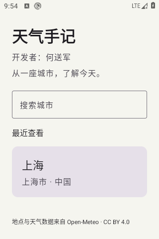
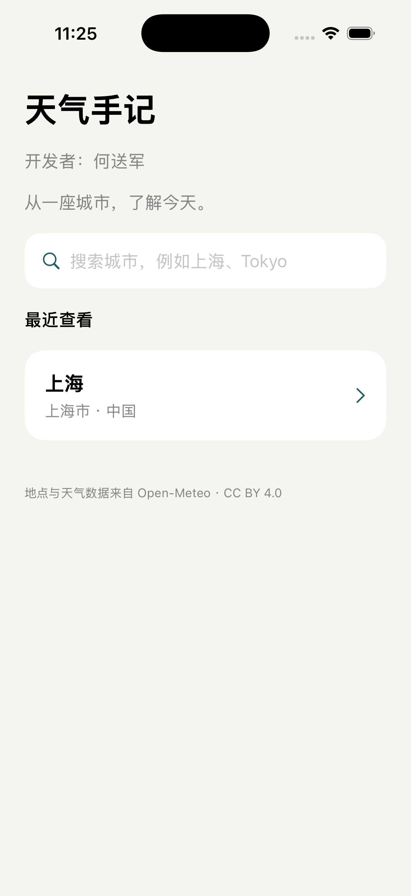
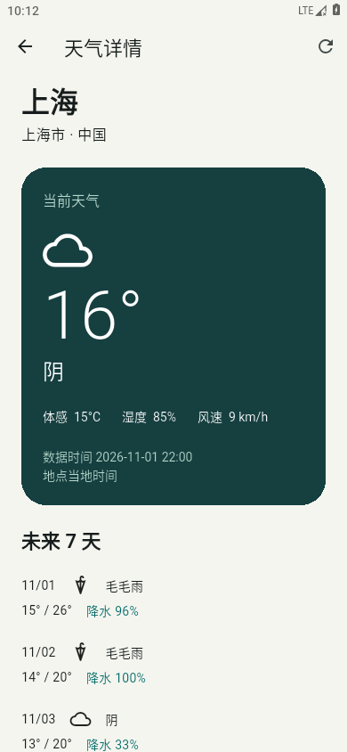
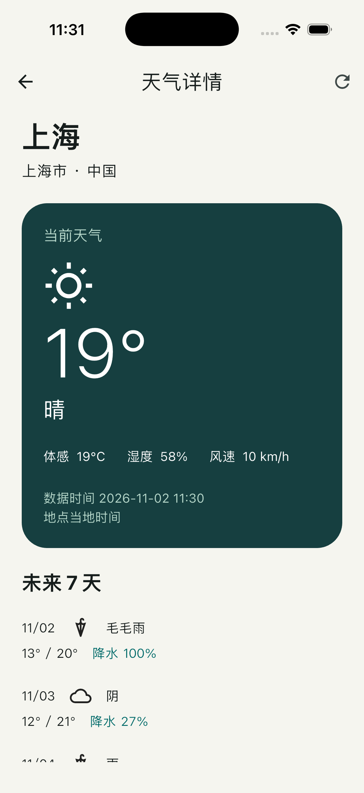

# 天气手记 · Native + Flutter

天气手记采用 **Android / iOS 原生主页 + Flutter 共享天气详情页**，支持城市搜索、当前天气与未来 7 天预报。原生主页负责城市检索与最近访问记录，Flutter 负责天气详情与交互逻辑。

- Android：Kotlin、Jetpack Compose、ViewModel / StateFlow。
- iOS：Swift、SwiftUI、ObservableObject、async/await。
- 共享天气页：Flutter、Riverpod、Dio。
- 数据：Open-Meteo，当前配置无需 API Key，界面已标注来源；使用范围见下文说明。

## 应用预览

以下为两端模拟器的实际运行截图，天气数据为截图时的在线结果。

### 原生首页

原生首页提供城市搜索、最近查看记录和进入 Flutter 天气详情页的入口。

| Android · Jetpack Compose | iOS · SwiftUI |
| --- | --- |
|  |  |

### Flutter 天气详情页

| Android | iOS |
| --- | --- |
|  |  |

## 核心功能

| 功能 | 行为 |
| --- | --- |
| 城市搜索 | 输入城市名称查询，通过行政区与国家区分同名地点；输入防抖 300 ms，并取消过期请求 |
| 当前天气 | 展示温度、体感温度、天气状况、相对湿度与风速 |
| 7 天预报 | 展示每日天气、最高 / 最低温度与降水概率 |
| 最近城市 | 天气首次成功加载后记录城市，去重并保留最近 5 条，支持再次进入 |
| 状态与恢复 | 搜索支持加载、空结果、错误与重试；天气支持首屏加载、刷新与失败重试，刷新失败保留已有数据 |

天气使用摄氏度、km/h 和地点当地日期。Open-Meteo 的 current 数据是天气模型计算结果，不承诺等同于当地气象站实时实测。最近城市分别保存在各自设备，不跨平台同步；退出天气页后不持久化天气缓存。应用不请求定位权限，不包含账户、后台任务或服务端。

## 架构与设计

| 层次 | 职责与实现 |
| --- | --- |
| Android 原生主页 | Compose 展示界面，ViewModel / StateFlow 管理搜索状态，Repository 负责地点请求，SharedPreferences 保存最近城市 |
| iOS 原生主页 | SwiftUI 展示界面，ObservableObject 在 MainActor 更新状态，async/await 与 URLSession 处理搜索，UserDefaults 保存最近城市 |
| Flutter 天气页 | UI 按天气卡、预报与状态组件组织；Riverpod Controller 管理页面状态，Dio Repository 请求并解析天气数据 |
| 宿主通信 | MethodChannel 传递城市与会话信息，处理首次加载成功通知及页面关闭 |

网络请求、业务模型、状态管理与界面展示分别组织。搜索和天气请求均通过取消任务与请求序号抑制旧响应，避免快速输入或重复刷新时覆盖新结果。天气加载与最近城市写入的错误分别处理，记录失败不会被误报为天气获取失败。

平台通道提供 `getLaunchContext`、`weatherLoaded`、`closeWeather` 三个方法。Flutter 主动获取启动参数，首次成功加载后通知宿主保存最近城市；宿主通过会话校验与幂等处理避免重复记录。每次进入天气页创建独立 FlutterEngine，退出时移除通道处理器并释放引擎，明确资源所有权。

详细数据流、协议和生命周期说明见 [架构文档](docs/architecture.md)。

## 运行准备（macOS）

锁定 Flutter **3.47.3** / Dart **3.13.3**。Android 使用 JDK 17、SDK 36、AGP 9.1.0、Gradle 9.3.1、Kotlin 2.4.0。Android 最低 API 24；iOS 最低 15.0。需要完整 Xcode，首次使用时完成其组件安装和许可流程。

```bash
# Flutter 不在 PATH 时指定 SDK 根目录；可以自行设置 JAVA_HOME、ANDROID_HOME 和 DEVELOPER_DIR。
export FLUTTER_ROOT=/absolute/path/to/flutter
./scripts/prepare.sh
```

脚本下载 Dart 依赖、生成 Flutter 的临时 Android/iOS 工程及 iOS Swift Package，并写入本机 Android SDK 路径。没有修改全局 Xcode 路径或系统 Java 配置。首次下载引擎和 Maven 依赖可能较慢。

### Android

在 Android Studio 打开 `android-host/`，选择 JDK 17，运行 `app`；或：

```bash
source scripts/env.sh
cd android-host
./gradlew :app:assembleDebug
./gradlew :app:installDebug
```

APK：`android-host/app/build/outputs/apk/debug/app-debug.apk`。

Flutter 3.47.3 的 Gradle 插件仍引用 AGP 旧扩展，因此宿主明确设置 `android.newDsl=false`；此项有弃用警告，升级到 AGP 10 前必须重新验证 Flutter 兼容性。Compose BOM 固定为兼容 SDK 36 的版本，不盲目升级到要求 SDK 37 的版本。

### iOS

准备完成后打开 `ios-host/WeatherHost.xcodeproj`，选择 `WeatherHost` scheme 和 iPhone 模拟器运行。项目通过本地 Swift Package Manager 依赖引入 Flutter，不依赖 CocoaPods，也不需要运行项目生成脚本。

```bash
source scripts/env.sh
xcodebuild -project ios-host/WeatherHost.xcodeproj -scheme WeatherHost \
  -configuration Debug -sdk iphonesimulator \
  -destination 'generic/platform=iOS Simulator' \
  -derivedDataPath .tools/ios-build CODE_SIGNING_ALLOWED=NO build
```

`prepare.sh` 默认只生成 Debug 依赖且不签名，可在无开发者证书时进行模拟器调试。Release 需要先执行 `FLUTTER_BUILD_MODE=release ./scripts/prepare.sh`，然后在 Xcode 选择自己的 Team 和 Bundle ID，重新完成签名及真机验证。切回 Debug 前重新执行默认准备命令。项目不包含个人证书或描述文件。

Debug 的 Info.plist 包含 Flutter 调试所需的本地网络声明，Release 不包含。

如果全局 `xcode-select` 指向 Command Line Tools，Flutter 3.47.3 在创建 XCFramework 时清空子进程环境，会丢失 `DEVELOPER_DIR`。准备脚本对此使用 `.tools/flutter_tools` 中的工具源码副本，局部保留该子进程环境；不修改安装的 SDK 或全局 Xcode 设置。升级 Flutter 时需要重新审查此兼容处理。

## 开发与调试

1. 在 Kotlin / Swift 搜索逻辑处打断点，观察防抖、取消及状态变化。
2. 在宿主的 `getLaunchContext` 处理器处打断点，观察原生城市如何转为 Dart 模型。
3. 打开天气页后，在 `weather_flutter/` 运行 `flutter --no-version-check attach`，连接调试与热重载。仅修改 Dart 通常热重载即可；原生及引擎代码需要重新构建。
4. 在 `weatherLoaded` 和 `closeWeather` 处观察 Dart → 原生回调。
5. 修改宿主集成时，检查首次进入、重复进入、系统返回、前后台切换和旋转时的生命周期与资源释放。

当前未使用引擎预热或缓存。若引入这些优化，需要评估首次进入耗时与常驻内存，并同步调整城市参数投递及会话管理协议。

## 项目结构

```text
android-host/
  app/              应用组装、Activity 导航、Flutter 通信
  core/model/       纯 Kotlin 城市模型与最近列表规则
  core/data/        地点 API、SharedPreferences 持久化
  feature/home/     Compose 搜索页和 ViewModel
ios-host/
  WeatherHost/      SwiftUI 页面、Flutter 生命周期与通信
  WeatherCore/      Swift Package：模型、搜索、状态、测试
  WeatherHostUITests/  跨原生与 Flutter 的在线冒烟测试
weather_flutter/
  lib/bridge/       宿主通信
  lib/domain/       城市、天气模型及天气代码映射
  lib/data/         天气 API 和错误映射
  lib/state/        Riverpod 页面状态与请求管理
  lib/ui/           当前天气、预报与状态组件
  test/             解析、协议、竞态、状态、布局测试
scripts/            准备、检查和在线冒烟入口
docs/architecture.md  通信协议、生命周期和工程取舍
docs/verification.md  实际验证结果与剩余风险
```

不提交 Flutter 的 `.android/`、`.ios/`、SDK 路径、构建输出和 IDE 个人配置。保留 `pubspec.lock` 与 Gradle Wrapper。iOS 项目已生成并作为源码交付，`create_ios_project.rb` 仅是可选的重建工具，需要 xcodeproj 1.27.0 gem；请勿用它覆盖已有自定义项目。

## 测试

已有测试结果和未验证范围见 [验证记录](docs/verification.md)，其中记录的是对应日期的执行结果，不代表当前环境已重新运行。可通过以下入口执行本地验证。

执行 `./scripts/check.sh`：Dart 静态检查、Flutter 单元 / 组件测试、Android 单元测试 / 构建 / Lint、Swift 核心层测试，以及 iOS 模拟器构建。测试命令遇到失败会退出。

在线冒烟测试需要模拟器 / 设备已启动，并且设备可访问 Open-Meteo：

```bash
./scripts/smoke-android.sh
IOS_SIMULATOR_ID=<simulator-uuid> ./scripts/smoke-ios.sh
```

冒烟测试覆盖原生搜索上海、查看 Flutter 预报、返回原生、最近城市及再次进入。iOS 另覆盖重启后的最近列表。外网不可用时，它们可能失败；核心单元测试和 Flutter 组件测试使用假数据，不依赖天气服务。

## 工程取舍与限制

- 原生主页分别使用平台 UI 与状态管理机制，天气展示、请求与错误处理通过 Flutter 共享；相应地，需要维护两端搜索实现及宿主通信。
- 每次进入创建独立引擎，资源生命周期与页面绑定；未采用常驻引擎，首次进入需承担引擎启动成本。
- 手动构造依赖，不引入 Hilt、数据库或代码生成；Android 使用模块边界，Flutter 按职责分目录。
- 只支持城市搜索，不承诺街道 / POI 精度；中文匹配无结果时可尝试完整名称或英文名。
- 原生历史记录仅存本机，不包含天气离线数据库。重新进入天气页需要网络。
- 公共 API 不保证可用性或特定地区网络质量，UI 提供重试。免费服务有速率限制且仅限非商业用途；商业发布需重新确认套餐和授权。
- 未包含商店上架、生产签名、PC 端或 CI 发布流水线。

## 数据与官方资料

- [Open-Meteo 天气 API](https://open-meteo.com/en/docs)
- [Open-Meteo 地点搜索 API](https://open-meteo.com/en/docs/geocoding-api)
- [Open-Meteo 使用条款](https://open-meteo.com/en/terms) / [CC BY 4.0](https://creativecommons.org/licenses/by/4.0/)
- [Flutter Add-to-App](https://docs.flutter.dev/add-to-app)
- [Android 源码集成](https://docs.flutter.dev/add-to-app/android/project-setup)
- [iOS Swift Package 集成](https://docs.flutter.dev/add-to-app/ios/project-setup)
