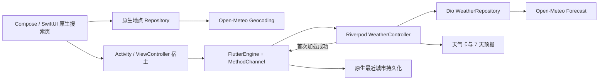

# 混合架构与通信

## 数据流



Android 的模型不依赖 Android。Repository 拥有网络取消和解析边界；ViewModel 拥有搜索任务和界面状态。Compose 以生命周期安全方式收集 StateFlow。最近城市由应用级 Store 持有，只承载本机状态，不启动后台协程。

iOS 的 WeatherCore 是可单独测试的 Swift Package，HomeModel 在 MainActor 更新状态，URLSession 请求支持任务取消。SwiftUI 只展示状态和发送用户操作。

Flutter 的 Repository 返回业务模型，Controller 维护数据、加载、错误状态。刷新开始不清空旧数据，失败不丢失已显示内容。每次请求增加序号并取消前一次 Dio 请求；即使底层无法取消，也不接受旧响应。网络成功与宿主回调失败分开处理，不会把最近记录写入失败误报成天气获取失败。

## 通道协议 v1

通道：`dev.weather/host`，三个方法均由 Flutter 调用原生处理。

`getLaunchContext` 无参数，响应示例：

```json
{
  "protocolVersion": 1,
  "sessionId": "unique-per-weather-page",
  "location": {
    "id": 1796236,
    "name": "上海",
    "latitude": 31.22222,
    "longitude": 121.45806,
    "admin1": "上海市",
    "country": "中国"
  }
}
```

`weatherLoaded` 参数为 `{"sessionId":"..."}`，成功响应 null。宿主校验会话并幂等地记录城市，只有第一次天气成功才写入。Flutter 若收到通道错误，保留天气并提示记录未同步，下次刷新重试通知。

`closeWeather` 参数为 `{"sessionId":"..."}`，成功响应 null，然后宿主关闭页面。城市参数读取失败时允许 null 会话请求返回，以免错误页无法退出；每个通道只绑定自己的宿主实例。过期会话返回 `session` 错误，已关闭实例拒绝调用，未知方法返回 NotImplemented。

使用 MethodChannel 而非 Pigeon，是因为这里只有三个小接口，手写 Map 更容易观察消息过程；原生和 Dart 边界均做参数校验，并用 Dart 协议测试和两端冒烟测试减少协议漂移。扩大接口规模后再考虑生成式类型安全协议。

## 生命周期

- Android 使用 FlutterActivity 默认新引擎路径，在 `configureFlutterEngine` 注册处理器，随后宿主运行 Dart 入口。显式要求引擎随宿主销毁，清理时移除处理器。
- Android Activity 的 Intent 保留城市参数，并通过 savedInstanceState 保存城市、会话和已通知标记。旋转由 FlutterActivity 处理配置变化；进程重建时重建引擎并重新请求天气。
- iOS 每次展示由 UIViewControllerRepresentable.Coordinator 拥有引擎，`run` 后在同一次主线程调用中注册处理器，Flutter 的平台调用在该线程后续处理。SwiftUI 拆除视图时移除通道、断开控制器并销毁引擎。
- iOS 由 SwiftUI 管理 Scene 和窗口，使用 FlutterAppDelegate；不替换 SwiftUI 的 SceneDelegate。FlutterViewController 处理页面可见性，首版不使用需要额外 Scene 回调的第三方原生插件；添加此类插件时需验证对应转发。
- Flutter 主动拉取启动参数，不使用只在引擎初次启动生效的 initialRoute 传递动态城市。
- Android 系统返回和 Flutter 返回按钮都回到原生主页；iOS 全屏页面使用 Flutter 返回按钮，关闭交互式下拉以统一退出路径。

## 失败恢复与回退

搜索失败在原生重试，天气失败在 Flutter 重试；无法解析城市时显示可返回的错误页。重复打开通过原生页面状态阻止。退出后请求失效，避免旧页面结果写入新页面。

工程集成失败时，先把 Flutter 页恢复为固定城市 / 静态页验证宿主与通道，再接回网络和状态层；不同时变更 SDK、Gradle、桥接协议和业务逻辑。SDK 版本固定在 `.flutter-version`，包版本固定在锁文件中。
